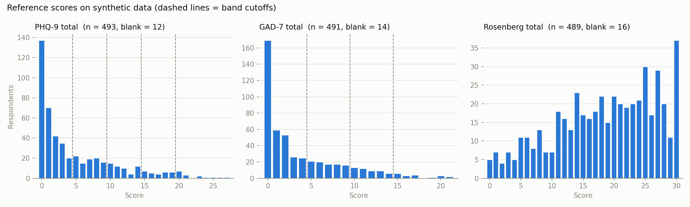
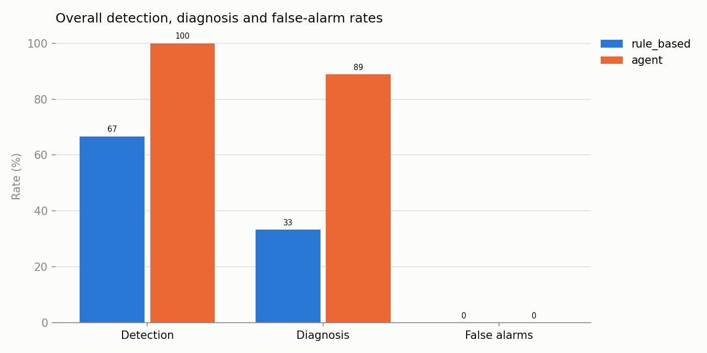
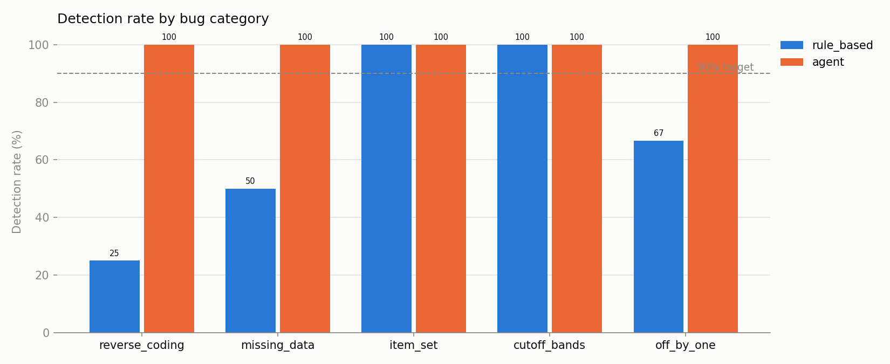
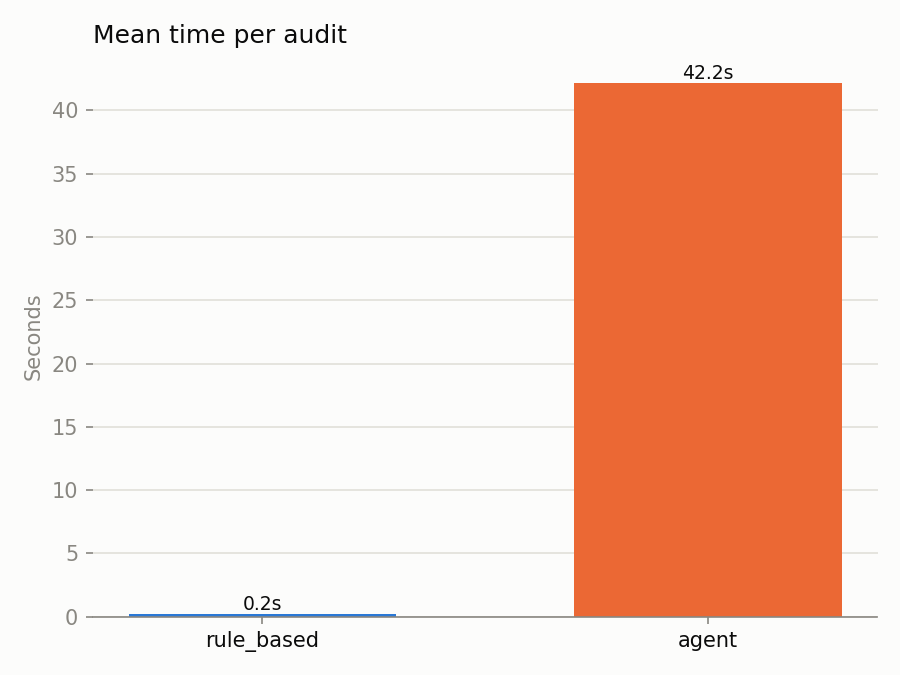

::: {.callout-note appearance="simple" icon="false"}
## Summary

Survey scoring pipelines can be wrong without anyone noticing. **I built an AI agent
from scratch** that reviews them the way a careful data manager would: it reads the
scoring rules, re-scores the data on its own, and investigates any mismatch, **without
ever seeing the pipeline's code**. I then built a test set with planted bugs to measure
whether it works.

On **22 test pipelines** (18 with a planted bug, 4 correct):

- **The agent detected all 18 bugs** and named the right type of bug for 16.
- **A standard rule-based QA script detected 12.** It missed every bug that produces
  plausible-but-wrong scores.
- **Neither raised a false alarm** on the 4 correct pipelines.
- **The agent took about 42 seconds per audit** on a free model tier; the script took
  under a second.

My hypothesis (at least 90% detection, under 5% false alarms) was **supported for the
agent and not for the script**. All data is synthetic and all questionnaires are public
domain.
:::

# The business problem

## What survey scoring is

Health and social research often measures things like depression, anxiety or
self-esteem with short questionnaires. Each question is answered on a small scale, for
example 0 = "not at all" to 3 = "nearly every day". **Scoring** turns a person's answers
into one number and a label that researchers can analyse:

1. **Add up the answers.** Nine answers on the PHQ-9 depression questionnaire give a
   total from 0 to 27.
2. **Flip the reversed questions.** Some questions are worded the opposite way ("I feel
   good about myself" vs "I feel like a failure"), so their answers must be flipped
   before adding.
3. **Handle skipped questions.** Decide whether a total can still be calculated when
   someone leaves a question blank.
4. **Assign a label.** For example, a PHQ-9 total of 10 to 14 means "moderate"
   depression.

In a study this is done by code, for thousands of people at once, often across several
questionnaires and several rounds of data collection. A useful comparison is an exam
grading script: if one answer in the key is wrong, every student's grade is slightly off,
yet nothing looks broken.

## Why errors go unnoticed

When scoring code has a mistake, nothing crashes. The scores still look like normal
scores, and they flow into analysis.

What a silent scoring error costs a research team:

- **Participants are misclassified.** Someone who is moderately depressed is labelled
  "mild", or a self-harm flag is never raised for follow-up.
- **Wrong results reach papers and reports.** Group comparisons, prevalence estimates
  and outcome trends all inherit the error.
- **Rework.** When it is finally noticed, every analysis built on those scores has to be
  rerun, often across several waves of data.
- **Data manager time.** Finding the cause of a mismatch by hand is slow, and manual QA
  usually means spot-checking a handful of rows, which misses errors that affect only a
  few participants.

## Why I built this

In research data management, scoring code is checked with automated QA scripts and
manual spot checks. Both catch obvious breaks, but neither reliably catches a score that
is plausible and wrong. I wanted to know whether an AI agent could act as an independent
second reviewer: one that reads the same scoring manual a person would, re-derives the
rules itself, and explains what went wrong in plain language.

**Question:** can an AI agent catch scoring errors that standard QA scripts miss, without
seeing the code it is checking?

**Hypothesis.** An agent that reads a scoring spec, re-scores the raw data
independently, and investigates mismatches will catch at least 90% of planted bugs with
a false-alarm rate under 5%.

# Why scripted QA misses these bugs

If the script missed bugs, was it just badly written? No. The rule-based checker runs the
checks a data team typically automates: totals in the valid range, labels consistent
with totals, blank totals exactly when too many answers are missing, and prorating flags
consistent with missingness. Those checks are correct, and they caught 12 of 18 bugs.
The 6 they missed come from limits that apply to any script. These limits are familiar
from data management on multi-cohort longitudinal research programs.

**Plausible-but-wrong output passes every consistency check.** A missed reverse-coded
item still gives totals in the valid range, labels that match those totals, and
normal-looking distributions. Nothing is broken; the numbers are simply wrong.

**A second scoring script repeats the same human interpretation.** The obvious fix is an
independent re-scorer, but it is written by a person reading the same manual, often
copying from the same source. If that source numbers the items differently (the
Rosenberg scale's reverse-item list differs between published versions), both scripts
make the same mistake and agree with each other.

**The rules live in documents, and they change.** Scoring rules sit in manuals,
protocols and protocol amendments. Across a longitudinal program, instrument versions
change between waves, item order differs by cohort or translation, missing codes differ
by site (-9, 99, blank), and amendments change the missing-data rule. Every change has to
be noticed and hand-coded into the QA script, which drifts out of date as silently as the
scoring code.

**Scripts only test what someone thought to test.** Python's built-in `round()` turns
10.5 into 10, not 11. In this data that changed 7 of 505 rows. No one writes a check for
a failure they did not anticipate.

**Scripts detect, but they don't diagnose.** At best a script reports "47 rows don't
match". Working out why is the slow, expensive part of QA.

# Approach

## What the agent does

An agent is an AI model working in a loop with tools. It is given a goal and decides each
next step itself, based on what it has seen so far.

The agent is given exactly three things: the scoring guides (written for humans, in plain
prose), the raw survey answers, and the pipeline's output. It never sees the pipeline's
code. It then:

1. reads the guides and writes its own scorer
2. compares its results with the pipeline's, column by column
3. looks for the pattern in any mismatch (only rows with skipped answers? only totals at
   a cutoff? one item?)
4. forms a hypothesis and **tests it** by reproducing the pipeline's exact output
5. writes a plain-English report with structured findings

This is the same principle as double data entry or double scoring, which research teams
already trust: an independent second reader of the same rules.

## How I built it

I built the agent from scratch, without an agent framework, so every part of it is
visible and explainable:

- **Language:** plain Python.
- **Model:** Gemini 3.5 Flash-Lite on Google's free tier, reached through the standard
  OpenAI-compatible interface, so switching provider is a one-line change.
- **Tools:** list files, read a file, run Python, and submit a report.
- **Guardrails:** the agent works in a temporary folder containing only its three inputs;
  it has a 40-turn budget with a warning near the end; every step is logged and
  automatically checked for any attempt to look at pipeline code or the answer key
  (none found).

**Tools used:** Python, pandas (data tables), PyYAML (scoring specs), openai (model
interface), matplotlib (charts), Quarto (this report).

## Test design

- **Questionnaires:** PHQ-9 (depression), GAD-7 (anxiety) and the Rosenberg Self-Esteem
  Scale, which has 5 reverse-coded items. Scoring rules were checked against official
  sources (see [Sources](#sources)). Where the official sources are silent (skipped
  answers, rounding), the rule is stated as a study convention.
- **Data:** 505 synthetic respondents with a fixed random seed, about 2% skipped answers,
  15 respondents who skip several items, and edge cases placed exactly on the cutoffs.
- **Test pipelines:** a correct scoring pipeline, plus 22 copies under shuffled names: 18
  with exactly one planted bug and 4 with none. A hidden answer key records which is
  which. Every planted bug was checked to change at least one output row (from 6 rows to
  all 505).
- **Bug types:** reverse coding (4), missing data (4), wrong items (3), severity cutoffs
  (4), off-by-one (3). Each maps to a real-world failure mode
  (see [Planted bugs](#planted-bugs)).

{#fig-scores}

**Measures.**

- **Detected:** at least one finding on a questionnaire the bug affects.
- **Diagnosed:** detected, and the finding names the right type of bug.
- **False alarm:** any finding on a correct pipeline.

# Hypothesis result

**Supported for the agent, not for the script.**

| | Rule-based QA script | AI agent |
|:---|:---|:---|
| Bugs detected | 12 of 18 (67%) | **18 of 18 (100%)** |
| Right type of bug named | 6 of 18 (33%) | **16 of 18 (89%)** |
| False alarms on correct pipelines | 0 of 4 | **0 of 4** |
| Time per audit | under 1 second | about 42 seconds |
| Meets hypothesis (≥90% detected, <5% false alarms) | No | **Yes** |

: Results on the 22 test pipelines {#tbl-results}

{#fig-overall}

# Findings

## The agent caught everything the script caught, plus all six it missed

The script missed 3 reverse-coding bugs, the rounding bug (7 rows), skipped answers not
being scaled up, and the self-harm flag reading the wrong question. The agent caught
all of them.

{#fig-category}

## It found the cause, not just the symptom

In its summary of the rules it applied, the agent recorded 97% of scoring rules
correctly. For 16 of 18 bugs it named the right type, usually after confirming the cause
by reproducing the pipeline's exact output.

## Example: one audit, step by step

Pipeline 20, where the hidden bug is that Rosenberg item 10 is not reverse-coded. These
are the agent's actual steps, condensed.

1. **Gets oriented.** Lists its files, checks the data's shape and columns, and reads all
   four guides.
2. **Builds its own scorer** from the guides. Its first attempt crashes; it fixes it and
   saves it as a reusable file.
3. **Compares every column:**

   ```
   phq9_total, phq9_band, phq9_prorated, phq9_self_harm_flag:  0 mismatches
   gad7_total, gad7_band, gad7_prorated:                       0 mismatches
   rses_total:                                               483 mismatches
   rses_prorated:                                              0 mismatches
   ```

   Only one column is wrong, and the prorating flag is fine, so it is not a
   missing-data problem.
4. **Investigates.** Looks at individual respondents item by item, then tests ideas that
   turn out to be wrong: other common reverse-item lists, a 1-4 coding, items shifted by
   one. None reproduce the pipeline's numbers.
5. **Searches systematically.** Tries every possible set of reversed items until one
   reproduces the pipeline exactly: *items 3, 5, 8 and 9 reversed, item 10 left out.*
6. **Confirms.** With that one mistake built into its own scorer, all 10 output columns
   match the pipeline for all 505 respondents.
7. **Reports**, in its own words: *"The scoring pipeline omits item 10 (rses_10) from
   reverse coding, reversing only items 3, 5, 8, and 9 instead of the required items
   3, 5, 8, 9, and 10."*

The path was not perfect (several crashed scripts and dead ends, 34 steps in total), but
the conclusion is specific, tested, and actionable. The full report and every step,
including the code the agent wrote, are in `reports/agent/pipeline_20/run_1/`.

## Depth costs time

{#fig-time}

The agent averaged 26 steps and about 42 seconds per audit, against under a second for
the script. On the free tier it cost nothing.

# Where it fell short

- **Wrong bug type, twice.** A loop that skips the last question, and question 8 counted
  twice, were both found but labelled as missing-data problems.
- **Noise, once.** On the "answers shifted by +1" bug it reported the real cause plus
  extra findings, one not tied to any questionnaire.
- **Severity cutoffs misrecorded** in its rule summary 23% of the time, although it still
  caught every cutoff bug.
- **Not a replacement for scripts.** Scripted checks are instant, free, deterministic and
  easy to audit. The agent is slower, can vary between runs, and is only as good as the
  documentation it is given.

# Recommendations

How a research team would use it:

| # | Recommendation | Why |
|:---|:---|:---|
| 1 | **Keep scripted checks as the first line** on every pipeline run | Instant, free, deterministic |
| 2 | **Run the agent as a second reviewer at high-risk moments:** a change to the scoring code, a new data wave, a new instrument or translation, a protocol amendment | Catches plausible-but-wrong errors scripts cannot see |
| 3 | **A data manager confirms each finding** before any scoring code or data is changed | The agent explains and recommends; people decide |
| 4 | **Real participant data only in an approved, secure environment** | This project uses synthetic data only |

: How a research team would use the agent {#tbl-recs}

**What success looks like:** fewer scoring errors reaching analysis, and less data manager
time spent finding the cause of a mismatch.

# Decisions and limitations

| Decision | What I chose | Why |
|:---|:---|:---|
| What the agent reads | Plain-prose scoring guides, not a structured spec | Closer to real work, where rules live in manuals |
| Baseline | A rule-based QA script | Answers "why use AI here at all?" with evidence |
| Independence | Agent never has the pipeline code; transcripts audited | A reviewer that reads the code can inherit its mistakes |
| Missing-data and rounding rules | Stated as study conventions | Official sources do not give them |
| Free tier, one run per pipeline | Gemini Flash-Lite, 22 audits | Zero cost; the trade-off is a smaller sample |

: Judgment calls {#tbl-decisions}

**Limitations.**

- **Small sample.** Each pipeline was audited once, and there were only 4 correct
  pipelines, so "0 false alarms" is encouraging rather than conclusive.
- **Planted bugs.** The bugs are synthetic, though each reproduces a real-world failure
  mode ([Planted bugs](#planted-bugs)).
- **A helpful guide.** The Rosenberg guide warns that other publications number the items
  differently, which may make one bug easier to find than in real life.
- **Synthetic data only.** Real data is messier.

# What I would do next

- Turn this into a full evaluation study: a blind, rubric-scored gold-standard set of 40
  new cases scored by a human reviewer, with agent-human agreement measured by percent
  agreement and Cohen's kappa (weighted for severity), and a data-driven "when to trust
  it / when a human should check" rule.
- Repeat each audit several times to measure consistency and firm up the false-alarm rate.
- Compare a lighter and a stronger model on accuracy, speed and cost.
- Add messier, non-scoring bugs: duplicate IDs, out-of-range values, mismatched merges.

# How to reproduce

```
python3 -m venv .venv
source .venv/bin/activate
pip install -r requirements.txt
cp .env.example .env    # then add a free Gemini API key
python harness/generate_data.py
python harness/make_copies.py
python harness/run_pipelines.py
python harness/check_harness.py
python -m evaluation.run_all --checker rule_based
python -m evaluation.run_all --checker agent
python -m evaluation.evaluate
python -m evaluation.plot_results
quarto render
```

Everything except the agent runs in under a minute with no API key. The agent takes
about 42 seconds per pipeline.

# Appendix {.unnumbered}

## Planted bugs {#planted-bugs .unnumbered}

| Planted bug | How it happens in practice |
|:---|:---|
| A reverse-coded item left out | Item list copied by hand; one item missed |
| Reverse list from a different item order | Scoring key copied from a publication or translation that numbers items differently |
| Reverse formula for the wrong scale (4 - x on 0-3 data) | Data recoded from 1-4 to 0-3 at export; scoring code not updated |
| Every item reversed | Reversal applied to the whole block instead of the flagged items |
| Missing code counted as 0 | Missing code (-9) not declared as missing |
| Prorating rule too lenient | Protocol amendment, or rule copied from another instrument |
| Python `round()` on .5 | Language default differs from the stated rounding rule |
| Skipped answers summed, not scaled up | Sum-scoring and mean-scoring rules mixed up |
| Item left out / item used twice | Copy-paste error in item lists |
| Unscored item added to total | An extra question that sits next to the scored items on the form |
| Cutoff boundary off by one | `<` used instead of `<=` |
| Severity bands from an unofficial sheet | Score sheets online that differ from the developer's manual |
| Answers coded 1-4 instead of 0-3 | Export setting changed between waves |
| Loop stops one item early | Off-by-one in a range or slice |
| Flag reads the neighbouring question | Wrong column after a form layout change |

: The 18 planted bugs map to 15 real-world failure modes {#tbl-bugs}

## Sources {#sources .unnumbered}

Checked October 2026.

**PHQ-9 and GAD-7**

- Kroenke K, Spitzer RL, Williams JBW. *Instruction Manual: Instructions for Patient
  Health Questionnaire (PHQ) and GAD-7 Measures.*
  <https://case.edu/medicine/wellness-pathway/sites/default/files/2018-05/instructions.pdf>.
  Public domain; no permission required. PHQ-9: 9 items scored 0-3, cutpoints 5, 10, 15,
  20. GAD-7: 7 items scored 0-3, cutpoints 5, 10, 15. The "difficulty" question is not
  scored. No missing-data rule given.
- PHQ Screeners: <https://www.phqscreeners.com/select-screener>
- Kroenke K, Spitzer RL, Williams JBW. 2001. The PHQ-9: validity of a brief depression
  severity measure. *J Gen Intern Med* 16(9):606-613.
- Spitzer RL, Kroenke K, Williams JBW, Löwe B. 2006. A brief measure for assessing
  generalized anxiety disorder: the GAD-7. *Arch Intern Med* 166(10):1092-1097.

**Rosenberg Self-Esteem Scale**

- University of Maryland, Department of Sociology. *Using the Rosenberg Self-Esteem
  Scale.* <https://socy.umd.edu/about-us/using-rosenberg-self-esteem-scale>. Reversed
  items 3, 5, 8, 9, 10 in the UMD item order; total 0-30.
- University of Maryland, Department of Sociology. *Rosenberg Self-Esteem Scale.*
  <https://socy.umd.edu/about-us/rosenberg-self-esteem-scale>. Public domain; no official
  cutoffs.
- Rosenberg M. 1965. *Society and the Adolescent Self-Image.* Princeton University Press.

**Study conventions (not from official sources)**

- A total is given if at most 1 item is missing, scaled up from the answered items;
  otherwise the total is blank.
- Scaled-up totals round to the nearest whole number, with .5 rounding up.
- -9, blank and out-of-range values all count as missing.
- GAD-7 scores 0-4 are labelled "minimal" (the manual does not name this band).
- Self-harm flag: any answer above 0 on PHQ-9 question 9.

**Discrepancies found during research**

- Many websites list the Rosenberg reverse items as 2, 5, 6, 8, 9; that list belongs to a
  different ordering of the same statements.
- A public GAD-7 score sheet (Healthify NZ) uses bands that do not match the official
  manual, including a "moderately severe" level the GAD-7 does not have.
